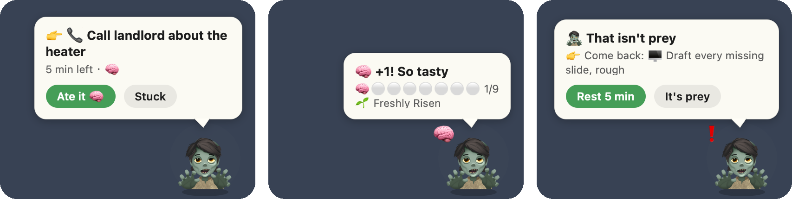

# Be a Zombie 🧟

Let the brain plan. You just shuffle.

Dump today's to-do list on Claude. It plans the day, and you only ever look at one thing: the block to do now.



- **Skill**: Claude turns your list into a realistic timetable with breaks built in. Report back ("ate it", "stuck", "I'm behind") and it hands out 🧠 and replans.
- **ZombiePet** (optional, Mac): a zombie on your desktop that shows the current block, pays out 🧠 when you click, and calls you back when you drift.

▶ [1-minute demo](promo/BeAZombie-promo-en.mp4) · [中文版](promo/BeAZombie-promo.mp4)

## Install

```bash
git clone https://github.com/YOUR_NAME/be-a-zombie && cd be-a-zombie && ./install.sh
```

| Needs | For |
|---|---|
| [Claude Code](https://claude.com/claude-code) | everything |
| macOS 13+ and `xcode-select --install` | the desktop pet |

Not on a Mac? `./install.sh --skills` installs only the skills.
Run the installer again to upgrade. Your plan, progress and profile are kept.

## Use

1. In Claude Code, say:
   > zombie mode. Today I need to read 3 papers, apply for internships, and book a flight.
2. Claude answers with the plan, and the zombie on your desktop wakes up.
3. Do the block it shows, then click **Ate it 🧠**.

| On the pet | What happens |
|---|---|
| **Ate it 🧠** | You get the block's brains, and the next block appears |
| **Stuck** | A 5-minute bite of the same block. It still earns a 🧠 |
| You open YouTube mid-block | After a minute: "That isn't prey" |
| Right-click the zombie | Compact bubble, large size, sounds, language, reminders |

中文用户：对 Claude 说“僵尸模式”，skill 和小僵尸会自动用中文。

## Privacy

- **Drift reminders** are judged on your Mac. The pet compares the frontmost app and the browser's current site with the list in `~/.zombie/config.json`. Nothing is stored or sent. macOS asks once before the pet may read the browser's site.
- **AI watch** is off by default and experimental. If you turn it on, the pet sends a screenshot to Claude through your own `claude` login every 5 minutes.

## How it fits together

The skill writes the day to `~/.zombie/plan.json`. The pet shows it and writes your progress to `~/.zombie/state.json`, which the skill reads before it replans.

## Uninstall

```bash
rm -rf ~/Applications/ZombiePet.app ~/.zombie ~/.claude/skills/be-a-zombie ~/.claude/skills/be-a-zombie-cn
```

## License

[MIT](LICENSE)
